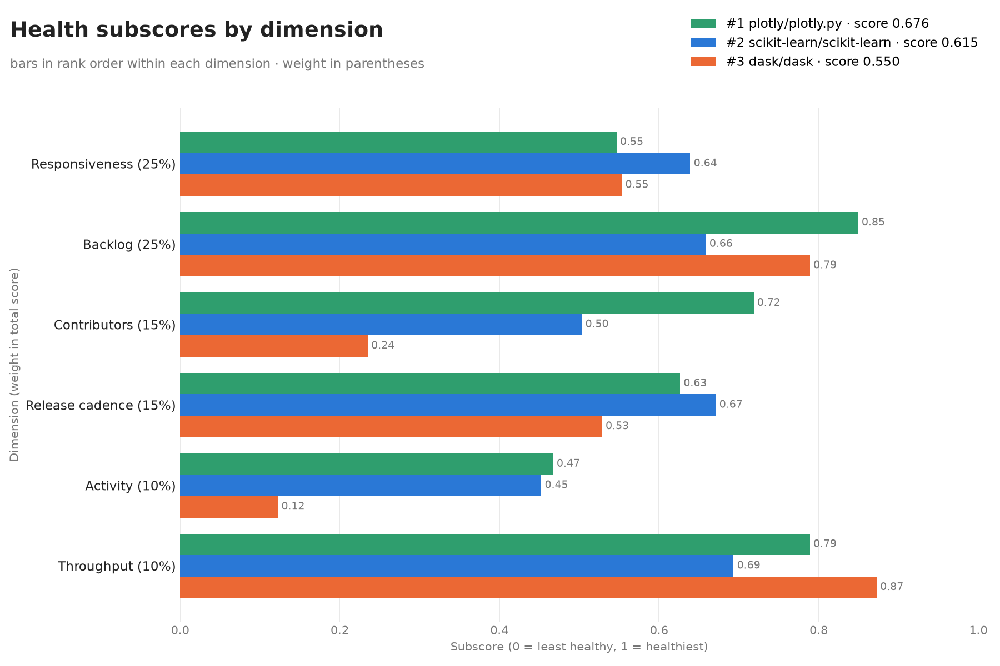
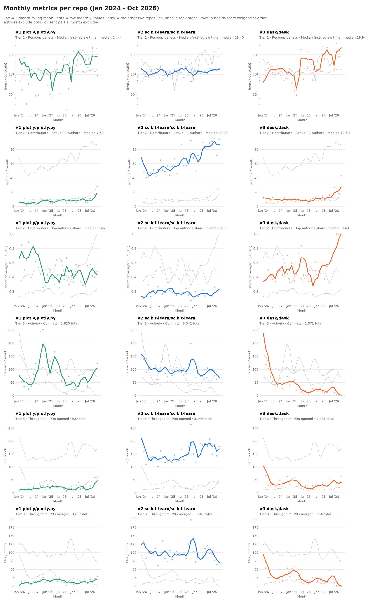
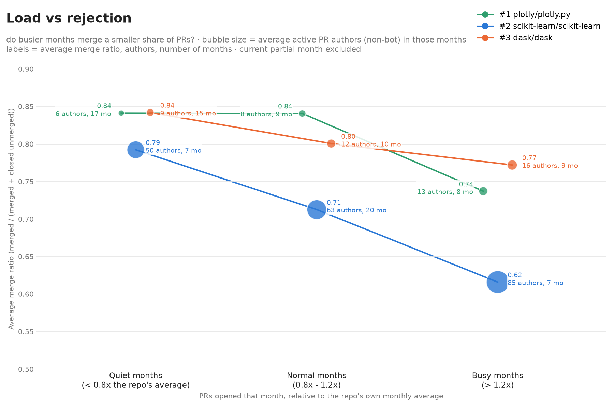
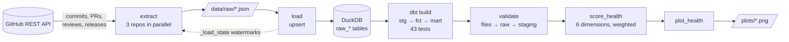

# Open Source Package Health Pipeline

An end-to-end data pipeline that measures how healthy an open source project's
development community is, using its GitHub activity. One Prefect flow pulls
commits, pull requests, reviews, and releases from the GitHub REST API, loads
them into DuckDB, models and tests them with dbt, validates the results in
Python, scores six health dimensions, and ranks the projects. It runs on a
monthly schedule as a Prefect deployment on Kubernetes.

**Stack:** Python 3.12 · Prefect 3 · DuckDB · dbt (dbt-duckdb) · GitHub REST API · matplotlib

> **Data snapshot:** the numbers and plots in this README come from the run on
> 2026-11-04 and do not include data after that date. The scheduled deployment
> keeps running monthly, but this write-up is not updated automatically.

**Contents**
- **Results:** [Ranking and findings](#results) · [Plots](#plots) · [How the score works](#how-the-score-works)
- **How it was built:** [Pipeline overview](#pipeline-overview) · [Extract](#extract) · [Load](#load) · [Transform](#transform-dbt) · [Validation](#validation) · [Pipeline-wide design](#pipeline-wide-design) · [Additional features](#additional-features) · [Tests](#tests)
- **Reference:** [Data quirks and limitations](#data-quirks-and-limitations) · [Setup and run](#setup-and-run) · [Repository layout](#repository-layout) · [Background](#background)

## Results

The flow ranks three Python data science packages from healthiest to least healthy development community.

| Repo                        | PRs created since 2024-01-01 | Commits since 2024-01-01 |
|-----------------------------|------------------------------|--------------------------|
| `scikit-learn/scikit-learn` | 5,228                        | 3,364                    |
| `dask/dask`                 | 1,231                        | 1,371                    |
| `plotly/plotly.py`          | 690                          | 2,829                    |

Analysis window: 2024-01-01 through the time of each run (35 months, January 2024 to November 2026, as of the last run).

### Ranking

| Rank | Repo                        | Health score (0–1) |
|------|-----------------------------|--------------------|
| 1    | `plotly/plotly.py`          | 0.676              |
| 2    | `scikit-learn/scikit-learn` | 0.615              |
| 3    | `dask/dask`                 | 0.550              |

With equal weights the order is the same (0.666 / 0.603 / 0.517). [How the score works](#how-the-score-works) explains the metrics and weights. [What the data shows](#what-the-data-shows-about-each-repo) covers dask's rank: its merging slowed sharply from July 2026 (1 merge each in August and September, against an average of 30.5 per month in 2024–25), and it has not merged a PR since 2026-09-29, though maintainers still review and close PRs.

### What the data shows about each repo

- **dask's merging slowed sharply from July 2026.** It merged 10 PRs in July, 1 each in August and September, and none in October, against an average of 30.5 a month in 2024–25. It has not merged a PR since 2026-09-29 (36 days at the last run). That does not prove it stopped: the gap before that one was 43 days, and maintainers still close PRs (10 since 2026-09-29) and review them (1 approval). Before July 2026 no gap between merges was longer than 21 days.
- **scikit-learn draws a large and growing number of first-time contributors** (595 of its 655 PR authors in 2026 opened their first PR in our data that year), and it merges a falling share of PRs (merge ratio 0.83 in 2024, 0.71 in 2025, 0.55 in 2026). Its low merge rate reflects outside PRs it declines, which is why merge rate has a low weight.
- **plotly has the smallest stale backlog** (14 of 93 open PRs), but 21 of its 45 Dependabot PRs are still open. Five PRs by one author were merged after 409–492 days, likely a batch of old work merged together.
- **Bots wrote few commits** (dask 3.9%, scikit-learn 0.6%, plotly 0.2%), so the bot rule changes little for commit counts.

## Plots

`plot_health` saves three PNGs to `plots/`. Every plot uses the same color per repo (plotly green, scikit-learn blue, dask orange) and lists the repos in rank order.

### Plot 1: Dimension profile



**Dimension profile.** Each group of bars is one scored dimension labeled with its weight, the bars within each group follow the final rank, and the legend gives each repo's rank and score. No repo leads every dimension. plotly ranks first because it has no weak spot. It has the smallest stale backlog (15% of its open PRs untouched for 180+ days, a backlog subscore of 0.85), the best contributor score (0.72), and it is second on throughput and narrowly first on activity. scikit-learn leads responsiveness (0.64) and release cadence (0.67), but 34% of its open PRs are stale. That is the largest stale backlog of the three, so it gets the lowest backlog subscore (0.66) on a dimension worth 25%. dask has the highest throughput (0.87) and a fairly small stale backlog (21%, subscore 0.79), but the lowest contributor (0.24) and activity (0.12) scores. Those two low scores match its merge slowdown since July 2026 and a growing share of merged PRs from its busiest author.

### Plot 2: Monthly trends



**Monthly trends.** Each column is one repo in rank order. Each row is a monthly measure from `mart_repo_monthly` that relates to one scored dimension, named in the panel subtitle, and the rows are ordered by that dimension's weight tier. These are not the scored metrics themselves, which are single values per repo in `mart_health_inputs`. The colored line is a 3-month rolling mean, the dots are the raw months, and the gray lines are the other two repos.

- **Median first-review time.** scikit-learn stays steady at about 11 to 16 hours. plotly and dask rise together in 2026 (plotly from 6.7 hours in 2025 to 27, dask from 10.5 to 61). A longer wait for a first review means contributors hear back more slowly, a sign that maintainers are falling behind the incoming work. Both repos received more PRs in 2026, most from people new to the project, so a larger review load is a likely cause.
- **Active PR authors.** plotly and dask have small groups of authors (about 6 to 12 a month) that stay level until a rise in mid to late 2026. scikit-learn has far more and keeps growing, from 51 a month in 2024 to 84 in 2026. A small, steady group can run a healthy project if it keeps up with its work. scikit-learn's growth is mostly first-time contributors (595 of its 655 PR authors in 2026 opened their first PR in our data that year), and its merge ratio fell from 0.83 in 2024 to 0.55 in 2026. The extra authors mostly bring more PRs for maintainers to review and turn down, not more maintainers. dask shows the same pattern on a smaller scale, with 157 first-time authors among its 166 in 2026. A late rise in new authors across all three repos may partly reflect AI-assisted contributions, which [ASSESSING-HEALTH.md](docs/course/ASSESSING-HEALTH.md) warns about.
- **Top author's share.** scikit-learn stays near 0.18, so no single person dominates its merges. plotly fell from 0.62 in 2024 to about 0.44, becoming less dependent on one person. dask rose from 0.46 to 0.72 and reaches 1.0 in August and September 2026, but those months had one merge each, so the 1.0 reflects a single PR rather than one person taking over.
- **Commits.** plotly moves in waves. Its biggest burst (245 and 253 commits in October and November 2024) came just before version 6.0.0 in January 2025, and commits rose again around version 7.0.0 in August 2026, which fits work being pushed ahead of major releases. scikit-learn is steady at about 100 a month with a slower 2026. dask started very high (237 commits in January 2024, 137 of them by one developer) and then fell to near zero. dask is not a new project settling down (its PR numbers were already above 10,000 in 2024), and its active authors went up while its commits went down. Together that points to a project that still receives contributions but is no longer merging them.
- **PRs opened and merged.** scikit-learn opens about 1,700 PRs a year and merges about 1,200, with a slower 2026 (889 merges in ten months). plotly opens a few more PRs each year and merges a steady 150 to 175. dask's two rows split apart in 2026, with PRs opened rising while merges fell to zero by October.

### Plot 3: Load vs. rejection



**Load vs. rejection.** Each repo's complete months are grouped by how many PRs were opened compared with that repo's own monthly average: quiet (under 0.8×), normal (0.8–1.2×), and busy (over 1.2×). Each bubble's height is the average merge ratio for that group, its size is the average number of active PR authors, and its label gives the merge ratio, authors, and number of months. Measuring load against each repo's own average keeps scikit-learn's size from dominating.

- **plotly handles changes in load best, which fits its first-place rank.** Its merge ratio is the same 0.84 in quiet and normal months, and its author count barely changes between them (6 and 8), so ordinary swings in incoming work don't change how it treats PRs. Only its busy months, with about twice as many authors (13), bring the ratio down to 0.74. dask and scikit-learn instead lose merge ratio at every step up in load while their authors climb steadily (dask 9, 12, 16; scikit-learn 50, 63, 85). plotly's busy months are also spread across all three years, so its pattern reflects load rather than one unusual period.
- **All three repos merge a smaller share of PRs in their busiest months, and busier months bring more authors.** scikit-learn drops the most, from 0.79 in quiet months to 0.62 in busy ones.
- **For scikit-learn the drop is mostly a change over time, not a reaction to load.** Five of its seven busy months are in 2026, all seven quiet months are in 2024 and 2025, and its overall merge ratio fell from 0.83 in 2024 to 0.55 in 2026. Within any single year its load and merge ratio barely move together (correlation between −0.14 and +0.03). The plot is consistent with the first-time contributors seen in plot 2, whose PRs scikit-learn merges less often, but it cannot show that a busy month by itself causes more rejections.
- **For plotly and dask the pattern is weaker and mixed.** Their per-month correlations are −0.32 and −0.08, and within single years they change direction. The bins average away a lot of month-to-month spread, so the lines look cleaner than the monthly data is.
- **What it means for the score.** A lower merge ratio in scikit-learn's busy recent months reflects a flood of outside PRs it declines, not necessarily weaker maintenance. This is why merge rate carries only 10% of the score ([How the score works](#how-the-score-works)).

## How the score works

`score_health` reads `mart_health_inputs`, turns each metric into a 0–1 subscore (1 = healthiest), combines the subscores with weights, ranks the repos, writes the table `health_scores`, and logs it to `logs/model.log`.

### Metrics (6 metrics, 6 dimensions)

| Dimension                | Metric                   | Definition                                                                                                                                                 | Healthier | dask    | plotly.py | scikit-learn |
|--------------------------|--------------------------|------------------------------------------------------------------------------------------------------------------------------------------------------------|-----------|---------|-----------|--------------|
| Responsiveness           | `pct_reviewed_within_7d` | Share of PRs (created since 2024, at least 7 days old) that got a first non-author, non-bot review within 7 days. Never-reviewed PRs count as not reviewed | higher    | 0.553   | 0.547     | 0.639        |
| Backlog                  | `pct_open_stale`         | Share of open PRs with no update in more than 180 days                                                                                                     | lower     | 0.211   | 0.151     | 0.341        |
| Contributor base (trend) | `top_author_share_trend` | Slope per month of the busiest author's share of merged non-bot PRs, over the 34 complete months. A rising share means more dependence on one person       | lower     | +0.0106 | −0.0087   | −0.0001      |
| Release cadence          | `release_gap_cv`         | Coefficient of variation (std ÷ mean) of days between full releases. Lower = more regular                                                                  | lower     | 0.943   | 0.747     | 0.658        |
| Activity (trend)         | `commit_trend`           | Slope per month of monthly commits ÷ average monthly commits, over the 34 complete months: change per month as a share of the average                      | higher    | −0.0755 | −0.0065   | −0.0095      |
| Throughput               | `merge_rate`             | Merged ÷ (merged + closed unmerged), PRs created since 2024                                                                                                | higher    | 0.873   | 0.789     | 0.693        |

**Size normalization:** every metric is a share, a ratio, or a slope divided by the repo's own average, never a raw count. scikit-learn has 7.6 times as many PRs as plotly, but that alone can't raise its score. The contributor metric uses the top author's *share*, not a bus-factor count, because a count of authors grows with project size.

**Trend component:** two metrics are slopes over the full window: `commit_trend` (is activity growing or shrinking?) and `top_author_share_trend` (is the project becoming more or less dependent on one person?). `top_author_share_trend` was added because it measures fragility without `commit_trend`'s caveats (commits are not all equally meaningful, and AI-assisted coding changes commit habits; [ASSESSING-HEALTH.md](docs/course/ASSESSING-HEALTH.md)).

### Standardization: fixed-range min-max

Each metric becomes a subscore with `(value − zero_at) ÷ (one_at − zero_at)`, clipped to 0–1. `zero_at` is the value that scores 0 (least healthy), `one_at` the value that scores 1. For lower-is-better metrics `zero_at > one_at`, so the same formula flips the direction (`SCORE_SPECS` in `main.py`).

| Metric                   | Scores 0 at     | Scores 1 at     | Actual values (dask / plotly / sklearn) | Subscores (dask / plotly / sklearn) |
|--------------------------|-----------------|-----------------|-----------------------------------------|-------------------------------------|
| `pct_reviewed_within_7d` | 0               | 1               | 0.553 / 0.547 / 0.639                   | 0.553 / 0.547 / 0.639               |
| `pct_open_stale`         | 1               | 0               | 0.211 / 0.151 / 0.341                   | 0.789 / 0.849 / 0.659               |
| `top_author_share_trend` | +0.02 per month | −0.02 per month | +0.0106 / −0.0087 / −0.0001             | 0.235 / 0.719 / 0.503               |
| `release_gap_cv`         | 2               | 0               | 0.943 / 0.747 / 0.658                   | 0.529 / 0.626 / 0.671               |
| `commit_trend`           | −0.10 per month | +0.10 per month | −0.0755 / −0.0065 / −0.0095             | 0.123 / 0.467 / 0.453               |
| `merge_rate`             | 0               | 1               | 0.873 / 0.789 / 0.693                   | 0.873 / 0.789 / 0.693               |

- Shares use their natural 0–1 range (stale share flipped).
- The other three ranges are my choice: wide enough that every repo falls inside them (no value is clipped), so each repo keeps its real distance from the others. dask's commit trend (−0.0755) is the closest to an end of its range.

**Why fixed ranges instead of the usual min-max across the three repos:** ordinary min-max always gives the best repo 1 and the worst 0 on every metric, however close they are. dask's 55.3% and plotly's 54.7% review rates would become 1.00 and 0.00, a large gap from a 0.6-point difference. Z-scores spread three repos the same way, and ranks keep only the order. Fixed ranges keep close repos close, and a repo's score doesn't change if the repo set changes. Plain min-max is the usual choice; the fixed ranges are my design. The ranking is the same under all three methods.

### Weights

Weights sum to 100, in three tiers ranked by how directly each metric measures health and how strong its caveats are. Within a tier, the two metrics were judged equally direct, so they get equal weight.

| Tier | Dimension        | Weight | Why                                                                                                                                                                                                                     |
|------|------------------|--------|-------------------------------------------------------------------------------------------------------------------------------------------------------------------------------------------------------------------------|
| 1    | Responsiveness   | 25     | Most direct sign that maintainers keep up with incoming work                                                                                                                                                            |
| 1    | Backlog          | 25     | Same, from the other end: work nobody returns to                                                                                                                                                                        |
| 2    | Contributor base | 15     | Important idea (dependence on one person), weaker metric: it measures change, not level, and the slopes are small                                                                                                       |
| 2    | Release cadence  | 15     | Regular is not always better; scikit-learn has only 15 release gaps to measure                                                                                                                                          |
| 3    | Activity         | 10     | Commit counts move for reasons other than health (commit habits, AI-assisted coding); the straight-line fit is weak for plotly and scikit-learn (R² 0.01 and 0.11)                                                      |
| 3    | Throughput       | 10     | Direction holds only up to a point: a higher merge rate means contributions get accepted, but a very high one can mean weak review, and a lower one can mean healthy strictness (scikit-learn rejects many outside PRs) |

### Ranking (`health_scores`, `logs/model.log`)

| Rank | Repo         | Score     | Responsiveness | Backlog | Contributors | Release cadence | Activity | Throughput |
|------|--------------|-----------|----------------|---------|--------------|-----------------|----------|------------|
| 1    | plotly.py    | **0.676** | 0.547          | 0.849   | 0.719        | 0.626           | 0.467    | 0.789      |
| 2    | scikit-learn | **0.615** | 0.639          | 0.659   | 0.503        | 0.671           | 0.453    | 0.693      |
| 3    | dask         | **0.550** | 0.553          | 0.789   | 0.235        | 0.529           | 0.123    | 0.873      |
|      | weight       |           | 25             | 25      | 15           | 15              | 10       | 10         |

### Robustness check

The flow also logs the ranking with equal weights (1/6 each; logged only, not stored): plotly 0.666, scikit-learn 0.603, dask 0.517. The order is the same.

This doesn't prove the weights are correct; weights are a judgment. It shows the ranking doesn't depend on them. plotly beats scikit-learn on 4 of 6 dimensions (backlog, contributors, activity, throughput), so the order only flips under extreme weights, such as putting about half the total on responsiveness. Our weights mainly reduce the influence of noisy metrics like commit trend. That narrows dask's gap (its weakest dimensions are activity and contributors) but doesn't change its rank.

## Pipeline overview



`rhk2dx-package-health-flow` in `main.py` runs six tasks in order:

| #   | Task                | What it does                                                                         | Output                                               |
|-----|---------------------|--------------------------------------------------------------------------------------|------------------------------------------------------|
| 1   | `extract` (subflow) | Fetches commits, pull requests, PR reviews, and releases for the 3 repos in parallel | `data/raw/<owner>__<repo>/<endpoint>/page_NNNN.json` |
| 2   | `load` (subflow)    | Upserts every landed record into one raw table per endpoint                          | `raw_*` tables, `_load_state`, `data/raw/_LOADED`    |
| 3   | `dbt_build`         | Runs `dbt build`: staging models, fact and mart tables, 43 tests                     | `stg_*`, `fct_*`, `mart_*`                           |
| 4   | `validate`          | Python checks from landed files to staging; outliers; descriptive statistics         | log only (fails the flow on a mismatch)              |
| 5   | `score_health`      | Scores 6 health dimensions from `mart_health_inputs`, weights them, ranks the repos  | `health_scores` table                                |
| 6   | `plot_health`       | Draws 3 plots                                                                        | `plots/*.png`                                        |

**Highlights**
- Incremental, resumable extraction: rate-limit aware, concurrent per repo, never re-downloads a landed page
- Idempotent upserts into DuckDB with load watermarks
- 8 dbt models and 43 tests (staging, facts, marts); `dbt build` runs inside the flow
- Python validation from landed JSON to staging, plus outlier detection
- Weighted health score with fixed-range standardization and an equal-weight robustness check

## Extract

### Endpoints and record counts (first full run, 2026-11-01)

| Endpoint      | Request                                                       | scikit-learn       | dask              | plotly.py       |
|---------------|---------------------------------------------------------------|--------------------|-------------------|-----------------|
| Pull requests | `/pulls?state=all&sort=updated&direction=desc`                | 6,400              | 1,500             | 900             |
| PR reviews    | `/pulls/{number}/reviews`, one call per PR created since 2024 | 18,260 (5,207 PRs) | 1,985 (1,224 PRs) | 1,592 (685 PRs) |
| Commits       | `/commits?since=2024-01-01T00:00:00Z`                         | 3,345              | 1,371             | 2,827           |
| Releases      | `/releases` (full history, small)                             | 51                 | 44                | 109             |

Total: 7,034 API requests. Every count above is logged per repo and endpoint in `logs/extract_full_run.log`.

- **Pull requests** have no date filter, so they are sorted by `updated` descending and paging stops once a page ends before the window start (`stop_before` in `fetch_pages`).
- **Reviews** are fetched for every PR created in the window, merged or not (`fetch_reviews`).
- **Pagination** follows the `Link` header's `rel="next"` URL with `per_page=100` until there is no next page.

### Rate limits

- **Primary limit:** `github_get` reads `X-RateLimit-Remaining` and `X-RateLimit-Reset` on every response. When 25 or fewer requests remain, it sleeps until the reset time plus 5 s. The 25-request buffer leaves room for the other two threads' requests that are already in flight.
- **Secondary limit:** a 403/429 with `Retry-After` sleeps that many seconds, then raises so Prefect retries ([Pipeline-wide design](#pipeline-wide-design)).
- 5xx errors and timeouts are retried by Prefect ([Pipeline-wide design](#pipeline-wide-design)).

### Concurrent fetching

`extract` runs one `fetch_repo` task per repo in parallel (`fetch_repo.map(...)` on a `ThreadPoolTaskRunner` with 3 workers). One token means one shared budget, so all threads share `RATE_LOCK`: when one thread sleeps off the rate limit it holds the lock, and every other thread waits at its next request.

### Landing files

`data/raw/<owner>__<repo>/<endpoint>/page_NNNN.json`, one file per response page, in the README format (`repo`, `endpoint`, `url`, `page`, `fetched_at`, `data`) plus one added field:

- `next_url`: the next page's URL (null on the last page). Resume uses it to continue from the last saved page without re-fetching.

Reviews are stored one folder per PR, `reviews/pr_<number>/page_NNNN.json`, so resume can tell which PRs are done.

Pages are written atomically: first to a `.tmp` file, then renamed (`write_page`). A crash mid-write leaves only a `.tmp` file, which the next run deletes; a half-written `.json` page can never exist.

### Resume after an interruption

When there is no `_LOADED` marker, the next run keeps `data/raw/`, skips every page already on disk, and continues from the saved `next_url`. Excerpt from the first full run, stopped with Ctrl-C after scikit-learn's pulls page 54 and restarted (`logs/extract_full_run.log`, lines 170–190):

```
18:00:01  [scikit-learn/scikit-learn] pulls page 54: 100 records (budget left 4437)
          ← Ctrl-C; restarted 2m 43s later
18:02:44  Extract starting (resume): 3 repos, window from 2024-01-01T00:00:00Z
18:02:45  [plotly/plotly.py] pulls: 9 pages on disk, already complete
18:02:45  [dask/dask] pulls: 15 pages on disk, already complete
18:02:45  [dask/dask] commits: 14 pages on disk, already complete
18:02:45  [scikit-learn/scikit-learn] commits: 34 pages on disk, already complete
...
18:02:45  [scikit-learn/scikit-learn] pulls: 54 pages on disk, resuming at page 55
18:02:47  [scikit-learn/scikit-learn] pulls page 55: 100 records (budget left 4430)
```

The budget went from 4,437 before the stop to 4,430 after the restart, so the pages already on disk cost no requests.

> **Note on the missing Ctrl-C line.** The warning `Ctrl-C received: stopping workers; pages on disk are kept for resume` was added to `extract` after this full run, so it does not appear in the excerpt above. It is confirmed by `tests/interrupt_test.py`, which sends a real Ctrl-C to a running extract (`logs/test_logs/interrupt_test.log`: the warning is logged and the workers stop 0.7 s later). The full run was not repeated to capture the line: the gap was found too close to the deadline, and a fresh full run costs about 7,000 requests and up to 70 minutes.

When `_LOADED` exists, everything on disk is already in DuckDB. The run moves `data/raw/` to `data/archive/raw_<UTC time>/` (kept for validation, instead of deleted) and fetches only records newer than the `_load_state` watermarks ([Load](#load)).

## Load

### Raw tables

One table per endpoint, one row per record (`load_table`):

| Table               | `id` (natural key) | `updated_at` from       |
|---------------------|--------------------|-------------------------|
| `raw_commits`       | `sha`              | `commit.committer.date` |
| `raw_pull_requests` | `number`           | `updated_at`            |
| `raw_pr_reviews`    | `id`               | `submitted_at`          |
| `raw_releases`      | `id`               | `updated_at`            |

Every table has the columns `repo`, `id`, `updated_at`, `fetched_at` (from the landing file), `source_file`, and `payload` (the full record as JSON), with `PRIMARY KEY (repo, id)`. All other fields stay in `payload`; the dbt staging models extract them.

### Idempotent loads

Each table is loaded with `INSERT OR REPLACE` on `(repo, id)`, so a record that is already in the table is replaced, never duplicated. `tests/load_full_test.py` loads the first full run's 7,291 landed pages twice into an empty database (`logs/test_logs/load_full_test.log`):

```
            first load                                     second load
raw_commits: 0 rows before, 7543 after          raw_commits: 7543 rows before, 7543 after
raw_pull_requests: 0 rows before, 8800 after    raw_pull_requests: 8800 rows before, 8800 after
raw_pr_reviews: 0 rows before, 21837 after      raw_pr_reviews: 21837 rows before, 21837 after
raw_releases: 0 rows before, 204 after          raw_releases: 204 rows before, 204 after
```

The test also checks that PR rows equal the distinct PRs in the files (8,800), and that `_load_state` has 12 rows (3 repos × 4 endpoints).

### Load state and incremental runs

After every table has loaded, `finish_load_task` writes `_load_state` (one row per repo and endpoint: newest `updated_at`, row count, load time) and only then creates `data/raw/_LOADED`.

On the next run, `extract` sees `_LOADED`, moves `data/raw/` to `data/archive/raw_<UTC time>/`, and reads the watermarks (`read_watermarks`):

| Endpoint      | Incremental rule                                                                  |
|---------------|-----------------------------------------------------------------------------------|
| Commits       | `since=` the newest loaded commit date                                            |
| Pull requests | Paging stops at the first page that ends before the newest loaded PR `updated_at` |
| Reviews       | Fetched only for PRs updated since the watermark (and created since 2024)         |
| Releases      | Fetched in full (1–2 pages per repo)                                              |

Records fetched again at a watermark boundary are replaced by the upsert, not duplicated.

### Request counts and row counts per run

| Run | Date (local)                                          | Type                                              | API requests | commits | PRs   | reviews | releases |
|-----|-------------------------------------------------------|---------------------------------------------------|--------------|---------|-------|---------|----------|
| 1   | Extract 2026-11-01 17:59–18:35; load 2026-11-02 13:22 | Full window (load task written after the extract) | 7,034        | 7,543   | 8,800 | 21,837  | 204      |
| 2   | 2026-11-02 13:25                                      | Incremental                                       | 61           | 7,549   | 8,811 | 21,871  | 204      |
| 3   | 2026-11-03 22:57                                      | Incremental (with dbt)                            | 60           | 7,563   | 8,828 | 21,913  | 204      |
| 4   | 2026-11-04 00:19                                      | Incremental; failed at validation (see note)      | 15           | 7,563   | 8,828 | 21,914  | 204      |
| 5   | 2026-11-04 00:23                                      | Incremental (with validation)                     | 13           | 7,563   | 8,828 | 21,914  | 204      |
| 6   | 2026-11-04 13:33                                      | Incremental (full flow)                           | 33           | 7,564   | 8,833 | 21,921  | 204      |

Request counts are from `Extract finished: N API requests this run` in `logs/extract.log`; row counts are from `logs/load.log`. An incremental run needs 13–61 requests instead of 7,034.

> Run 4 completed extract, load, and dbt, then failed when validation opened the database read-only. dbt keeps a read-write connection open in the same process, and DuckDB refuses a second connection with different settings. Validation now connects with default settings; run 5 passed 4 minutes later.

## Transform (dbt)

`dbt build` runs inside the flow (`dbt_build`, using `PrefectDbtRunner` as in [DBT-REFERENCE.md](docs/course/DBT-REFERENCE.md)). It runs `dbt deps`, then builds every model and runs every test, and raises if any model or test fails. This is the only task that runs dbt. Staging models are views; marts are tables, so the tests read stored results (`dbt_project.yml`). Last run: `PASS=51 ERROR=0` (8 models, 43 tests) in about 4 s.

### Staging models (one per raw table)

| Model               | Columns (from `payload`)                                                                                | Rows dropped                          |
|---------------------|---------------------------------------------------------------------------------------------------------|---------------------------------------|
| `stg_commits`       | `sha`, `author_login`, `committed_at` (from `commit.author.date`), `is_bot`                             | none                                  |
| `stg_pull_requests` | `number`, `author_login`, `state`, created/updated/closed/merged times, `is_bot`                        | none                                  |
| `stg_pr_reviews`    | `id`, `pr_number` (parsed from `pull_request_url`), `reviewer_login`, `state`, `submitted_at`, `is_bot` | `PENDING` reviews (no `submitted_at`) |
| `stg_releases`      | `id`, `tag_name`, `published_at`, `prerelease`                                                          | drafts                                |

- Timestamps are cast with `::timestamptz` (GitHub returns UTC; the dbt profile sets `TimeZone: UTC`).
- Deduplication: `qualify row_number() over (partition by repo, id order by fetched_at desc) = 1` keeps the newest copy of each record.

**Bot rule:** `is_bot = user.type = 'Bot' OR user.login LIKE '%[bot]'`, applied to the PR author, the reviewer, and the commit author, and wrapped in `coalesce(..., false)`. 23 commits have no linked GitHub account (the commit email isn't tied to a user). Their login is NULL, so without the `coalesce` their `is_bot` would be NULL; with it, they count as not bots.

### Fact marts

**`fct_pull_requests`**: one row per PR created on or after 2024-01-01, with the core flags and durations: `is_merged`, `is_closed_unmerged`, `is_open`, `first_review_at`, `hours_to_first_review`, `reviewed_within_7d`, `hours_to_merge`, `hours_to_close`, `is_stale`, `has_approving_review`.

- A review counts only if it is not by the PR author and not by a bot. A review by a deleted account (NULL login) does not count, because it can't be shown to be a non-author.
- Run time is `max(fetched_at)`, so a rebuild without new data gives the same results.
- `is_stale` = open and not updated for more than 180 days before run time.

**`fct_releases`**: one row per published release on or after 2024-01-01. `days_since_previous` uses `lag()` over all releases before the window filter, so the first release in the window still measures its gap to the one before it. **Added column:** `days_since_previous_full` is the gap to the previous *full* release (NULL for prereleases). Release regularity in the health score uses it, because an rc or beta build is not the same event as a release, and counting it would split one gap into two.

### Aggregate marts

**`mart_repo_monthly`**: one row per repo × month, January 2024 through the run month (35 months × 3 repos). The month list comes from `generate_series` crossed with the repos, so a month with no activity shows 0 instead of disappearing. It has the core columns, plus two:

- `month_index` (0 = January 2024): the x-axis for the trend slopes.
- `top_author_share`: the share of the month's merged non-bot PRs written by the busiest author. It is NULL when a month has no merges, so an empty month doesn't look perfectly spread out.

**`mart_health_inputs`**: one row per repo, one column per health-score metric ([How the score works](#how-the-score-works)). Every column is a share, ratio, or slope, never a raw count. Validation, scoring, and plotting read durations and rates from these marts; no Python code recomputes them.

### How medians treat open PRs

Open PRs are kept in `fct_pull_requests` with `is_open = true`. They are never dropped and never given a fake close date: their `merged_at` and `closed_at` stay NULL, so `hours_to_merge` and `hours_to_close` are NULL.

`median()` skips NULLs. So:
- **`median_merge_hours`** covers only PRs merged that month; open and closed-unmerged PRs drop out.
- **`median_first_review_hours`** covers only reviewed PRs; open PRs without a review drop out.

### Tests (43, plus 8 models = 51 in `dbt build`)

| Type         | Where                                      | What it checks                                                                                                                                                                                                                                                                                                                                                                                          |
|--------------|--------------------------------------------|---------------------------------------------------------------------------------------------------------------------------------------------------------------------------------------------------------------------------------------------------------------------------------------------------------------------------------------------------------------------------------------------------------|
| Generic (12) | `models/staging/schema.yml`                | `unique` + `not_null` on `sha`, review `id`, release `id`; `(repo, number)` unique for PRs (`dbt_utils.unique_combination_of_columns`) and `number` not null; `committed_at` not null; `relationships` from `stg_pr_reviews.pr_number` to `stg_pull_requests.number`; `accepted_values` on PR `state` (`open`, `closed`) and review `state` (`APPROVED`, `CHANGES_REQUESTED`, `COMMENTED`, `DISMISSED`) |
| Generic (29) | `models/marts/schema.yml`                  | Unique keys: `(repo, number)`, `(repo, month)`, release `id`, `repo` in `mart_health_inputs`; `not_null` on keys, dates, and every health-score metric; `accepted_values` on PR `state`; `dbt_utils.accepted_range`: durations and release gaps ≥ 0, shares and ratios between 0 and 1                                                                                                                        |
| Singular     | `tests/assert_pr_closed_after_created.sql` | No PR closed or merged before it was created                                                                                                                                                                                                                                                                                                                                                            |
| Singular     | `tests/assert_review_after_pr_created.sql` | No review submitted before its PR was created                                                                                                                                                                                                                                                                                                                                                           |

Results print to the terminal during the run and are saved in `logs/dbt.log`, for example:

```
9 of 51 PASS assert_pr_closed_after_created ......... [PASS in 1.29s]
10 of 51 PASS assert_review_after_pr_created ........ [PASS in 1.38s]
```

`schema.yml` in each folder describes every model and column; the raw tables are declared as dbt sources in `models/staging/sources.yml`.

## Validation

`validate` is a Python task (no dbt) that runs after dbt. It runs every check, logs the results, and raises once at the end if any completeness check failed, so one run lists every problem. Numbers below are from the last flow run (2026-11-04 13:33, `logs/validate.log`).

### Completeness checks

| Check                        | How                                                                                                                                 | Last run                                              |
|------------------------------|-------------------------------------------------------------------------------------------------------------------------------------|-------------------------------------------------------|
| Landed files → raw tables    | Every distinct `(repo, id)` in the landed JSON, in `data/raw/` **and** every `data/archive/raw_*/` folder, must be in the raw table | 12 of 12 repo × endpoint pairs: 0 missing             |
| Raw → staging                | Raw row count minus rows staging drops on purpose (`PENDING` reviews, draft releases) must equal the staging row count              | 12 of 12 match (0 dropped rows this run)              |
| Commits every complete month | Every repo has at least one commit in every complete month (the run month is exempt)                                                | 1 zero-commit month, passed by the sanity check below |

**Zero-commit sanity check (an addition to the README rule).** A complete month with 0 commits fails, unless that month also had 0 merged PRs. Every merge adds a commit, so a month with no merges and no commits means an inactive repo, not lost data. It is logged as a warning:

```
WARNING [dask/dask] 2026-10: 0 commits. Passed by the secondary sanity check (0 merged PRs, 64 opened): the repo was inactive that month, not missing data.
```

The archive folders are checked too, so the check covers every record ever landed, not only the latest incremental run's files.

### Outliers

All flagged records are **kept**: none are capped or dropped. They are real merges and real work, and the statistics use medians and 90th percentiles, which a few extreme values barely move.

**Time to merge: 55 PRs flagged.** PRs get separate cutoffs by author type, because a wait that is normal for a person means an automated PR got stuck:

| Author | Cutoff                                                                                             | Why this cutoff                                                                                                                                                                  | dask | plotly.py | scikit-learn |
|--------|----------------------------------------------------------------------------------------------------|----------------------------------------------------------------------------------------------------------------------------------------------------------------------------------|------|-----------|--------------|
| Human  | Above the repo's 99th percentile of merged human PRs (dask 92.5 days, plotly 333.3, sklearn 302.1) | Only PRs far outside the normal range. The 90th percentile would flag 465 human PRs and the 95th 234; the 90th percentile is already reported as part of the typical range below | 9    | 5         | 34           |
| Bot    | More than 7 days                                                                                   | Bot PRs (dependency updates) normally merge within hours to 3 days                                                                                                               | 3    | 1         | 3            |

Notable: the 5 plotly PRs are all by one author and took 409–492 days, likely a batch of old PRs merged together. The longest overall is scikit-learn #28464 at 777 days.

<details>
<summary>All 55 flagged PRs (from <code>logs/validate.log</code>)</summary>

```
[dask/dask] PR #12057 by dependabot[bot] (bot): 134.0 days to merge (cutoff 7.0)
[dask/dask] PR #12328 by dependabot[bot] (bot): 79.8 days to merge (cutoff 7.0)
[dask/dask] PR #12334 by dependabot[bot] (bot): 35.6 days to merge (cutoff 7.0)
[dask/dask] PR #10812 by joanrue (human): 215.3 days to merge (cutoff 92.5)
[dask/dask] PR #11118 by phofl (human): 160.5 days to merge (cutoff 92.5)
[dask/dask] PR #12010 by DimitriPapadopoulos (human): 118.3 days to merge (cutoff 92.5)
[dask/dask] PR #12002 by DimitriPapadopoulos (human): 115.8 days to merge (cutoff 92.5)
[dask/dask] PR #11965 by faulaire (human): 115.2 days to merge (cutoff 92.5)
[dask/dask] PR #12024 by DimitriPapadopoulos (human): 96.6 days to merge (cutoff 92.5)
[dask/dask] PR #11128 by dstansby (human): 93.8 days to merge (cutoff 92.5)
[dask/dask] PR #12041 by DimitriPapadopoulos (human): 93.8 days to merge (cutoff 92.5)
[dask/dask] PR #11875 by rjzamora (human): 92.9 days to merge (cutoff 92.5)
[plotly/plotly.py] PR #5775 by dependabot[bot] (bot): 13.8 days to merge (cutoff 7.0)
[plotly/plotly.py] PR #5232 by robertoffmoura (human): 491.5 days to merge (cutoff 333.3)
[plotly/plotly.py] PR #5311 by robertoffmoura (human): 426.6 days to merge (cutoff 333.3)
[plotly/plotly.py] PR #5262 by robertoffmoura (human): 426.4 days to merge (cutoff 333.3)
[plotly/plotly.py] PR #5310 by robertoffmoura (human): 425.9 days to merge (cutoff 333.3)
[plotly/plotly.py] PR #5285 by robertoffmoura (human): 409.2 days to merge (cutoff 333.3)
[scikit-learn/scikit-learn] PR #33917 by dependabot[bot] (bot): 18.6 days to merge (cutoff 7.0)
[scikit-learn/scikit-learn] PR #29981 by dependabot[bot] (bot): 8.1 days to merge (cutoff 7.0)
[scikit-learn/scikit-learn] PR #32981 by dependabot[bot] (bot): 7.1 days to merge (cutoff 7.0)
[scikit-learn/scikit-learn] PR #28464 by marikabergengren (human): 777.1 days to merge (cutoff 302.1)
[scikit-learn/scikit-learn] PR #29026 by hchau630 (human): 693.6 days to merge (cutoff 302.1)
[scikit-learn/scikit-learn] PR #28760 by jeremiedbb (human): 687.1 days to merge (cutoff 302.1)
[scikit-learn/scikit-learn] PR #29532 by blitchj (human): 626.7 days to merge (cutoff 302.1)
[scikit-learn/scikit-learn] PR #29499 by ArturoAmorQ (human): 626.4 days to merge (cutoff 302.1)
[scikit-learn/scikit-learn] PR #29641 by snath-xoc (human): 571.5 days to merge (cutoff 302.1)
[scikit-learn/scikit-learn] PR #28043 by StefanieSenger (human): 540.9 days to merge (cutoff 302.1)
[scikit-learn/scikit-learn] PR #29661 by EmilyXinyi (human): 512.2 days to merge (cutoff 302.1)
[scikit-learn/scikit-learn] PR #30869 by adrinjalali (human): 501.2 days to merge (cutoff 302.1)
[scikit-learn/scikit-learn] PR #29155 by agitter (human): 491.7 days to merge (cutoff 302.1)
[scikit-learn/scikit-learn] PR #31413 by adrinjalali (human): 488.1 days to merge (cutoff 302.1)
[scikit-learn/scikit-learn] PR #30859 by adrinjalali (human): 454.1 days to merge (cutoff 302.1)
[scikit-learn/scikit-learn] PR #28971 by OmarManzoor (human): 450.0 days to merge (cutoff 302.1)
[scikit-learn/scikit-learn] PR #29097 by lorentzenchr (human): 445.3 days to merge (cutoff 302.1)
[scikit-learn/scikit-learn] PR #28755 by marijavlajic (human): 441.9 days to merge (cutoff 302.1)
[scikit-learn/scikit-learn] PR #29307 by maf-rnmourao (human): 439.7 days to merge (cutoff 302.1)
[scikit-learn/scikit-learn] PR #30508 by lucyleeow (human): 431.7 days to merge (cutoff 302.1)
[scikit-learn/scikit-learn] PR #29022 by deepyaman (human): 412.9 days to merge (cutoff 302.1)
[scikit-learn/scikit-learn] PR #32042 by lorentzenchr (human): 406.6 days to merge (cutoff 302.1)
[scikit-learn/scikit-learn] PR #31127 by lorentzenchr (human): 400.5 days to merge (cutoff 302.1)
[scikit-learn/scikit-learn] PR #29310 by icfaust (human): 400.3 days to merge (cutoff 302.1)
[scikit-learn/scikit-learn] PR #28559 by myenugula (human): 391.0 days to merge (cutoff 302.1)
[scikit-learn/scikit-learn] PR #30134 by SuccessMoses (human): 378.7 days to merge (cutoff 302.1)
[scikit-learn/scikit-learn] PR #30751 by snath-xoc (human): 368.6 days to merge (cutoff 302.1)
[scikit-learn/scikit-learn] PR #28981 by cynddl (human): 349.6 days to merge (cutoff 302.1)
[scikit-learn/scikit-learn] PR #29651 by Shashank1202 (human): 348.9 days to merge (cutoff 302.1)
[scikit-learn/scikit-learn] PR #31177 by dschult (human): 334.2 days to merge (cutoff 302.1)
[scikit-learn/scikit-learn] PR #31289 by EngineerDanny (human): 329.8 days to merge (cutoff 302.1)
[scikit-learn/scikit-learn] PR #32789 by nandan2003 (human): 322.1 days to merge (cutoff 302.1)
[scikit-learn/scikit-learn] PR #29151 by ArturoAmorQ (human): 320.2 days to merge (cutoff 302.1)
[scikit-learn/scikit-learn] PR #30041 by ogrisel (human): 316.3 days to merge (cutoff 302.1)
[scikit-learn/scikit-learn] PR #32587 by cakedev0 (human): 314.8 days to merge (cutoff 302.1)
[scikit-learn/scikit-learn] PR #29716 by AdrianoCLeao (human): 310.7 days to merge (cutoff 302.1)
[scikit-learn/scikit-learn] PR #30564 by ogrisel (human): 303.5 days to merge (cutoff 302.1)
```

</details>

**Weekly commits: 4 weeks flagged.** Cutoff: above Q3 + 3 × IQR of that repo's weekly commit counts (Tukey's "far out" rule). Bot commits are counted so an automated burst would show; none of the 4 weeks had any.

| Repo         | Week of    | Commits | Bot commits | Cutoff |
|--------------|------------|---------|-------------|--------|
| dask         | 2024-01-08 | 77      | 0           | 46     |
| dask         | 2024-01-15 | 75      | 0           | 46     |
| plotly.py    | 2024-10-21 | 98      | 0           | 93     |
| scikit-learn | 2025-10-06 | 83      | 0           | 53     |

### Descriptive statistics

Read from `fct_pull_requests`, `mart_repo_monthly`, and `fct_releases`; no durations are recomputed. Medians and percentiles skip PRs that were never reviewed or never merged ([Transform](#transform-dbt)).

| Repo         | First review p50 (h) | First review p90 (h) | Merge p50 (h) | Merge p90 (h) | Commits / week | Releases / year |
|--------------|----------------------|----------------------|---------------|---------------|----------------|-----------------|
| dask         | 12.3                 | 211.5                | 12.3          | 216.8         | 9.3            | 15.5            |
| plotly.py    | 16.1                 | 693.2                | 41.3          | 1,130.1       | 19.1           | 8.8             |
| scikit-learn | 13.1                 | 275.2                | 36.6          | 837.5         | 22.6           | 5.3             |

Releases per year count full releases only (prereleases excluded, as in [Transform](#transform-dbt)), divided by the time from 2024-01-01 to the run.

**Note on dask's releases per year.** dask's GitHub Releases start on 2024-04-19; earlier versions were published as git tags only, which the Releases endpoint does not return. Its 44 releases are therefore divided by a period about 3.5 months longer than the one they cover, so 15.5 per year **understates** its rate. Measured from its first GitHub Release it is 17.3 per year. dask has the most releases per year either way. Release regularity ([How the score works](#how-the-score-works)) is not affected, because it uses the gaps between releases, not a rate.

## Pipeline-wide design

### Retries and error handling

Only extract talks to the network, so it is the only task with retries.

| Failure                                                  | Where                                   | What happens                                                                                                                                                                                                                                                                                                                                                       |
|----------------------------------------------------------|-----------------------------------------|--------------------------------------------------------------------------------------------------------------------------------------------------------------------------------------------------------------------------------------------------------------------------------------------------------------------------------------------------------------------|
| Any failed request (4xx, 5xx, timeout, connection error) | `github_get`                            | `response.raise_for_status()` raises `httpx.HTTPError`                                                                                                                                                                                                                                                                                                             |
| Broken JSON in a response                                | `fetch_pages`                           | `response.json()` raises `ValueError`                                                                                                                                                                                                                                                                                                                              |
| Either of the above                                      | `fetch_pages`                           | Caught, logged with context (`[repo] endpoint page N failed: <error>`), then re-raised                                                                                                                                                                                                                                                                             |
| Secondary rate limit (403/429 with `Retry-After`)        | `github_get`                            | Sleeps the number of seconds GitHub asks for, then raises, so the retry happens after the wait                                                                                                                                                                                                                                                                     |
| The re-raised error                                      | `fetch_repo` task, `retry_if_transient` | Transient failures (403/429, 5xx, timeouts, connection errors, broken JSON) are retried up to 3 times, with increasing delays of 10, 30, and 60 s. Pages already on disk are skipped, so a retry costs only the requests that had not succeeded. Permanent failures (other 4xx, such as 404 or 401) fail at once, because they would fail the same way every time. |
| Ctrl-C                                                   | `extract`, `retry_if_transient`         | Workers stop at their next request or sleep. A Ctrl-C stop is never retried.                                                                                                                                                                                                                                                                                       |

Load through plot work on local files and the database. A failure there (a bad file, a failed dbt test, a validation mismatch) would fail again on a retry, so these tasks have no retries and fail the flow immediately.

### Logging

Each task has its own Python logger with a file handler, and the same logger is routed into Prefect (`PREFECT_LOGGING_EXTRA_LOGGERS`), so every line appears in the terminal, in the Prefect UI, and in a file:

| Task         | Log file                             | What the log records (purpose)                                                                                                                |
|--------------|--------------------------------------|-----------------------------------------------------------------------------------------------------------------------------------------------|
| 1 Extract    | `logs/extract.log`                   | Every page fetched with its record count and remaining rate-limit budget; rate-limit sleeps; resume points; total API requests per run        |
| 2 Load       | `logs/load.log`                      | Row count before and after each raw table upsert, which shows loads are idempotent; `_load_state` update and `_LOADED` marker                 |
| 3 dbt        | `logs/transform.log`, `logs/dbt.log` | `transform.log`: start and finish of `dbt deps` and `dbt build`, with the pass count. `dbt.log`: every model built and every test's PASS/FAIL |
| 4 Validation | `logs/validate.log`                  | Completeness checks (landed files → raw → staging, commits every month), flagged outliers, descriptive statistics                             |
| 5 Model      | `logs/model.log`                     | The ranked table (score, rank, 6 subscores) and the equal-weight robustness check                                                             |
| 6 Plot       | `logs/plot.log`                      | The path of each saved PNG                                                                                                                    |

Python tests write their own logs to `logs/test_logs/` ([Tests](#tests)).

## Additional features

| Item                 | Status        | Where                                                                                                                                                                                                                                                                                      |
|----------------------|---------------|--------------------------------------------------------------------------------------------------------------------------------------------------------------------------------------------------------------------------------------------------------------------------------------------|
| Concurrent fetching  | Done          | `extract`: one `fetch_repo` task per repo on a 3-worker `ThreadPoolTaskRunner`, with a shared `RATE_LOCK` ([Extract](#extract))                                                                                                                                                                      |
| Scheduled deployment | Done          | Monthly on the 28th at midnight Eastern on `uvasds-k8s-pool`; `python main.py --deploy`. Command, settings, and the manually triggered run's log are in [DEPLOYMENTS.md](DEPLOYMENTS.md)                                                                                                   |
| API odometer         | Done          | Every request passes through `github_get`, which adds 1 to a thread-safe counter (`API_REQUESTS`, `ODOMETER_LOCK`). The flow resets it at the start and logs it at the end, even if a task fails. Unlike `extract`'s own count, it also counts requests from attempts that Prefect retried |
| GraphQL ingestion    | Not attempted |                                                                                                                                                                                                                                                                                            |

Odometer from a local incremental run (2026-11-04 21:21 EST), matching extract's own count:

    Extract finished: 23 API requests this run
    API odometer: 23 GitHub API requests this flow run

Server deployment runs are full runs, about 7,000 requests each, because every run starts from a fresh clone with no data (see DEPLOYMENTS.md).

## Tests

Every Python test works on a temporary folder or a temporary copy of `packages.duckdb`, so the real data and database are never changed. Each test saves its output to `logs/test_logs/<test name>.log`, overwritten on every run, so the latest result can be read without rerunning it. The pipeline's own log lines from a test also go to the normal task logs in `logs/`.

| Task         | Test                       | What it checks                                                                                                                                                                    | API requests |
|--------------|----------------------------|-----------------------------------------------------------------------------------------------------------------------------------------------------------------------------------|--------------|
| 1 Extract    | `test_fetch_pages.py`      | Pagination follows the `Link` header across several pages                                                                                                                         | ~5           |
| 1 Extract    | `folder_structure_test.py` | Landing files use the README path and format, one file per page, no leftover `.tmp` files                                                                                         | ~5           |
| 1 Extract    | `pulls_reviews_test.py`    | Pull-request paging stops at the window start; one review call per PR created in the window; a rerun makes 0 requests                                                             | 15–40        |
| 1 Extract    | `rate_limit_test.py`       | Against a fake GitHub: sleeps until reset when the budget is low, honors `Retry-After`, raises on 403/404/5xx, connection errors, and broken JSON, and sends nothing after Ctrl-C | 0            |
| 1 Extract    | `resume_test.py`           | After a simulated crash (missing pages plus a half-written `.tmp`), only the missing pages are fetched                                                                            | ~7           |
| 1 Extract    | `interrupt_test.py`        | A real Ctrl-C stops a running extract within 5 s, logs the warning, and leaves no `.tmp` files                                                                                    | 10–30        |
| 1 Extract    | `extract_flow_test.py`     | The full extract subflow on a one-week window lands all four endpoints for all three repos; a rerun makes 0 requests                                                              | 50–150       |
| 1–2          | `incremental_test.py`      | A second extract + load fetches only records since the watermark, archives the first run's files, and loses no rows                                                               | 100–120      |
| 2 Load       | `load_full_test.py`        | The first full run's files loaded twice give identical row counts; one row per distinct record; 12 `_load_state` rows; `_LOADED` created                                          | 0            |
| 4 Validation | `validate_test.py`         | `validate` passes on the real data, then fails and names the record after one raw row is deleted                                                                                  | 0            |
| 5 Model      | `score_test.py`            | `health_scores` has one row per repo ranked 1–3, every score and subscore is between 0 and 1, and a second run gives the same table                                               | 0            |
| 6 Plot       | `plot_test.py`             | All three PNGs are written and non-empty                                                                                                                                          | 0            |

The transform stage's tests are the dbt tests ([Transform](#transform-dbt)), which run inside the flow.

To run them all (about 200–360 API requests in total, a few minutes):

```bash
for t in tests/*_test.py tests/test_fetch_pages.py; do printf "%-32s" "$t"; python "$t" >/dev/null 2>&1 && echo PASS || echo FAIL; done
```

Last runs (2026-11-04): all 12 passed. A test run outside a flow prints a harmless Prefect warning, `Logger ... attempted to send logs to the API without a flow run id`.

## Data quirks and limitations

### Data quirks handled in the pipeline

- **dask's GitHub Releases start on 2024-04-19.** Earlier versions were git tags only, which the Releases endpoint does not return. Its releases per year (15.5) understates its rate (17.3 measured from its first release). Release regularity is not affected.
- **plotly has 4 prereleases in the window.** They are kept in the data but left out of release regularity and releases per year ([Transform](#transform-dbt)).
- **7 plotly commits have author dates before 2024** (commits fetched by commit date can carry an older author date). They are in `stg_commits` but fall outside the monthly marts.
- **23 commits have no linked GitHub account.** They count as non-bot ([Transform](#transform-dbt)).

### Limitations

- **Medians cover only finished steps.** Review and merge medians skip PRs still waiting, so they can look faster than the real experience of an open PR. The stale-backlog and reviewed-within-7-days shares cover the waiting PRs instead.
- **"First-time" contributors means first seen in our data.** PR data starts with PRs updated since 2024, so someone whose earlier PRs were all older counts as new.
- **Commit counts are an imperfect activity measure.** Commit habits differ between projects, and AI-assisted coding can raise commit and PR counts without more real work ([ASSESSING-HEALTH.md](docs/course/ASSESSING-HEALTH.md)). That is why commit trend has the lowest weight.
- **The fixed scoring ranges and the weights are judgment calls.** The equal-weight check shows the ranking does not depend on the weights ([How the score works](#how-the-score-works)), but different ranges would change the subscores.
- **The ranking is a snapshot.** The window grows with every run, so scores move as new months arrive, especially for dask while its merging is slow.
- **Plot 3 cannot separate load from time.** scikit-learn's busy months are mostly in 2026, when its merge ratio fell for other reasons ([Plots](#plots)).

## Setup and run

### Requirements

- Python 3.12
- A GitHub personal access token. A classic token with no scopes is enough, because all three repos are public.
- All Python dependencies are pinned in `requirements.txt` (dbt-core 1.12.6, dbt-duckdb 1.11.1, duckdb 2.0.0, httpx 0.28.1, prefect 3.9.0, prefect-dbt 0.7.25).

### Setup

```bash
git clone https://github.com/MaxGuryan9/oss-package-health-pipeline.git
cd oss-package-health-pipeline
uv venv .venv --python 3.12        # or: python3.12 -m venv .venv
source .venv/bin/activate
uv pip install -r requirements.txt  # or: pip install -r requirements.txt
export GH_PAT=<your token>
```

The token is read from the `GH_PAT` environment variable. When that variable is not set, as on the Prefect server during a deployment run, it is loaded from the Prefect Secret block `rhk2dx-pat` instead (`TOKEN` in `main.py`). The token is never written to a file in the repo, and `.gitignore` excludes `.env` files.

Nothing else needs to be set up: the flow runs `dbt deps` itself, and it creates `data/`, `logs/`, and `packages.duckdb` on the first run.

### Run

```bash
python main.py
```

This runs one Prefect flow, `rhk2dx-package-health-flow`: extract → load → dbt build → validate → score → plot.

To publish the monthly scheduled deployment instead (see [Additional features](#additional-features) and `DEPLOYMENTS.md`):

```bash
python main.py --deploy
```

### Expected runtime

| Run                                      | API requests | Time                                                                           | Source                                                                                                |
|------------------------------------------|--------------|--------------------------------------------------------------------------------|-------------------------------------------------------------------------------------------------------|
| First run (full window, nothing on disk) | 7,034        | Extract about 35 min; load, dbt, validation, scoring, and plots add under 15 s | `logs/extract_full_run.log` (2026-11-01, 17:59 → 18:35, including a 3-minute deliberate interruption) |
| Later runs (incremental)                 | 13–61        | About 20 s for the whole flow                                                  | `logs/extract.log` → `logs/plot.log` (2026-11-04: 33 requests, 19 s)                                  |

A first run needs more requests than the 5,000-per-hour limit. In the measured run, GitHub's hourly reset came partway through, so the flow never had to sleep. A run that starts with a full 5,000 budget will use it in about 24 minutes, then sleep until the reset. That makes a first run take up to about 70 minutes.

**Tip: start a full run shortly before your rate limit resets.** GitHub's limit is not reset on the clock hour. It resets one hour after the first request of the current window. A full run that starts shortly before a reset gets a fresh 5,000 requests early, so it has little or no sleep. That is what happened in the measured run: the budget reset about 10 minutes after the start, at 18:08:46 (`logs/extract_full_run.log`), so the run never slept. To check your remaining requests and reset time (this call does not count against the limit):

```bash
curl -s -H "Authorization: Bearer $GH_PAT" https://api.github.com/rate_limit | grep -A3 '"core"'
```

`reset` is a Unix timestamp; `date -r <reset>` (macOS) shows it as a local time.

### Outputs

- `packages.duckdb`: raw tables, dbt models, and the `health_scores` ranking
- `plots/*.png`: three plots
- `logs/`: one log per task (`extract`, `load`, `transform`, `validate`, `model`, `plot`), plus dbt's own `dbt.log`

## Repository layout

```
oss-package-health-pipeline/
├── main.py                        # the Prefect flow and all six tasks
├── requirements.txt               # pinned dependencies
│
├── dbt_project.yml                # dbt project: staging = views, marts = tables
├── profiles.yml                   # dbt connection: packages.duckdb, UTC (no secrets)
├── packages.yml                   # dbt package dbt_utils (installed by `dbt deps` in the flow)
├── package-lock.yml               # pinned dbt package version
├── models/
│   ├── staging/
│   │   ├── sources.yml            # raw_* tables declared as dbt sources
│   │   ├── schema.yml             # staging tests
│   │   ├── stg_commits.sql
│   │   ├── stg_pull_requests.sql
│   │   ├── stg_pr_reviews.sql
│   │   └── stg_releases.sql
│   └── marts/
│       ├── schema.yml             # descriptions and tests for every mart and column
│       ├── fct_pull_requests.sql
│       ├── fct_releases.sql
│       ├── mart_repo_monthly.sql
│       └── mart_health_inputs.sql
│
├── tests/
│   ├── assert_pr_closed_after_created.sql   # dbt singular test
│   ├── assert_review_after_pr_created.sql   # dbt singular test
│   └── *_test.py, test_fetch_pages.py       # Python tests (see Tests)
│
├── plots/                         # the three PNGs written by the plot task
│   ├── dimension_profile.png
│   ├── monthly_trends.png
│   └── load_vs_rejection.png
│
├── DEPLOYMENTS.md                 # deployment command, settings, and the manual server run's log
│
├── docs/
│   └── course/                    # reference files supplied with the course (not our work)
│       ├── PROJECT_INSTRUCTIONS.md   # the assignment text (was the template's README.md)
│       ├── CHECKLIST.md              # submission checklist
│       ├── ASSESSING-HEALTH.md       # background on measuring open source health
│       ├── DBT-REFERENCE.md          # dbt layout, profiles, and PrefectDbtRunner reference
│       ├── DEPLOYMENT-INSTRUCTIONS.md  # Prefect deployment instructions (was the lower half of DEPLOYMENTS.md)
│       └── EXTRAS.md                 # instructor tips
│
└── README.md                      # this write-up
```

dbt reads `tests/` for singular tests (`test-paths` in `dbt_project.yml`), so the dbt tests and the Python tests share that folder.

**Not committed** (in `.gitignore`), because each is created by running the flow, holds local state, or is not project output:

| Excluded                                | What it is                                                                                    |
|-----------------------------------------|-----------------------------------------------------------------------------------------------|
| `data/`                                 | Landed API pages (`data/raw/`) and earlier runs' pages (`data/archive/`)                      |
| `packages.duckdb`                       | The database                                                                                  |
| `logs/`                                 | Task logs, `dbt.log`, and test logs (`logs/test_logs/`)                                       |
| `target/`, `dbt_packages/`              | dbt build output and installed dbt packages                                                   |
| `.venv/`                                | The virtual environment                                                                       |
| `images/`                               | Local reference images for plot styling (not project output)                                  |
| `.env`, `__pycache__/`, `tests/output/` | Secrets, Python caches, test scratch files                                                    |

## Background

Built for DS 3022 at the University of Virginia School of Data Science, Fall 2026.
The original project brief and course reference material are in [docs/course/](docs/course/).
